<div align="center">

<picture>
  <source media="(prefers-color-scheme: dark)" srcset="docs/assets/hero-dark.png">
  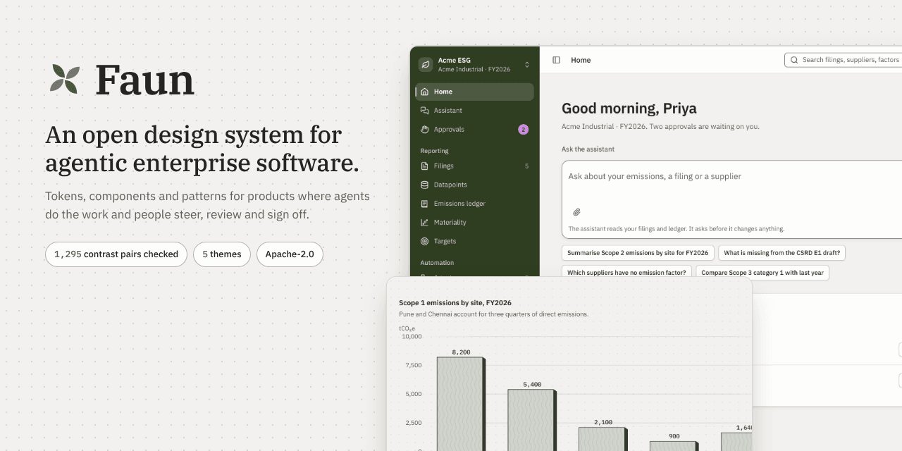
</picture>

[Documentation](https://saquibpm.github.io/faun-design-system) · [Quick start](#install-in-three-steps) · [Gallery](#see-it) · [Roadmap](docs/ROADMAP.md) · [Changelog](CHANGELOG.md) · [Contributing](CONTRIBUTING.md)

</div>

**Faun is an open design system for products where agents do the work and people steer, review and sign off.** Tokens, accessible React components, data visualisation, agentic components and patterns, with a contrast contract that fails the build.

[](LICENSE)
[](CHANGELOG.md)
[](https://github.com/SaquibPM/faun-design-system/actions/workflows/ci.yml)


## See it

Everything below is a real component or pattern from the [documentation site](https://saquibpm.github.io/faun-design-system), captured in light and dark. Your viewer picks the matching image.

| | |
| --- | --- |
| <a href="https://saquibpm.github.io/faun-design-system"><picture><source media="(prefers-color-scheme: dark)" srcset="docs/assets/gallery-foundations-dark.png">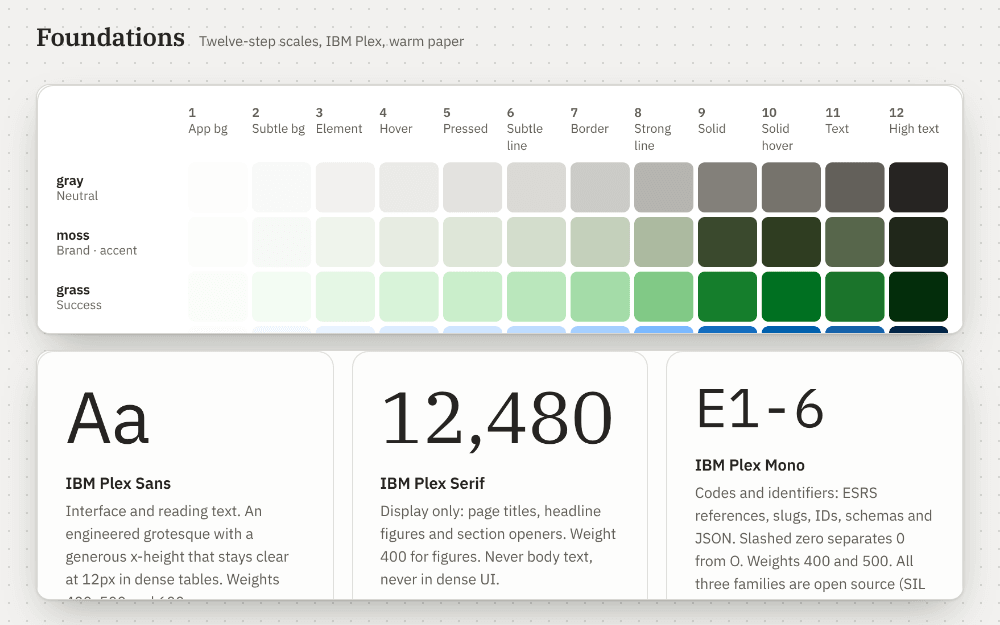</picture></a><br><sub><b>Foundations</b></sub> | <a href="https://saquibpm.github.io/faun-design-system"><picture><source media="(prefers-color-scheme: dark)" srcset="docs/assets/gallery-components-dark.png">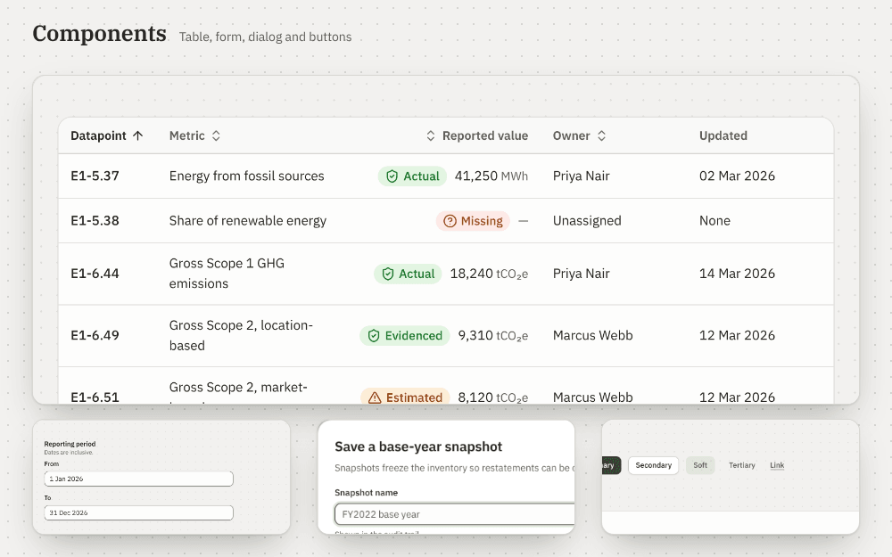</picture></a><br><sub><b>Components</b></sub> |
| <a href="https://saquibpm.github.io/faun-design-system"><picture><source media="(prefers-color-scheme: dark)" srcset="docs/assets/gallery-dataviz-dark.png">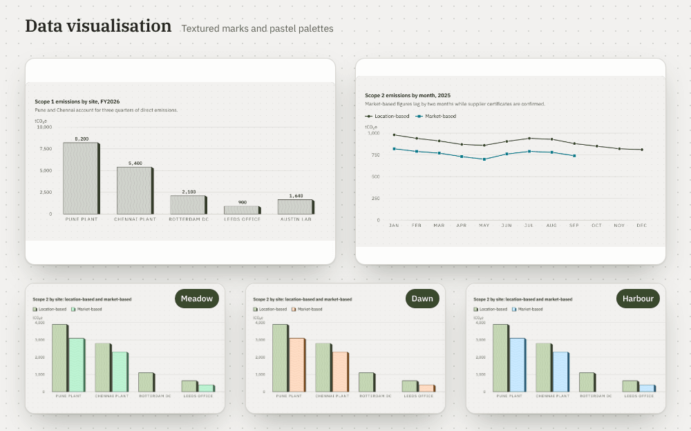</picture></a><br><sub><b>Data visualisation</b></sub> | <a href="https://saquibpm.github.io/faun-design-system"><picture><source media="(prefers-color-scheme: dark)" srcset="docs/assets/gallery-ai-dark.png">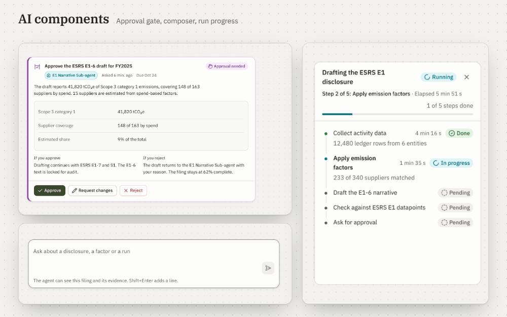</picture></a><br><sub><b>AI components</b></sub> |
| <a href="https://saquibpm.github.io/faun-design-system"><picture><source media="(prefers-color-scheme: dark)" srcset="docs/assets/gallery-patterns-dark.png">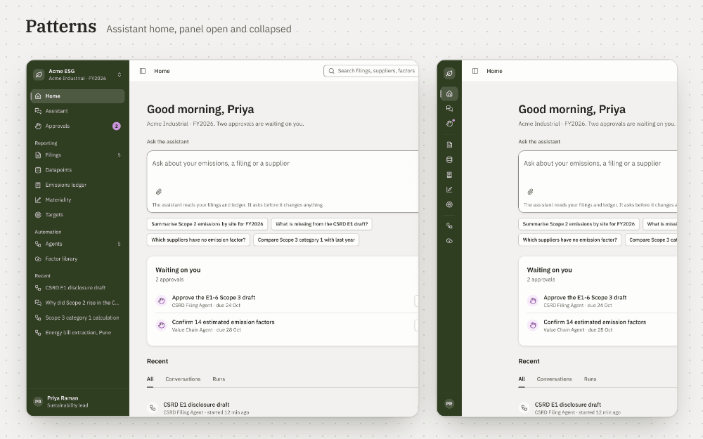</picture></a><br><sub><b>Patterns</b></sub> | <a href="https://saquibpm.github.io/faun-design-system"><picture><source media="(prefers-color-scheme: dark)" srcset="docs/assets/gallery-chat-dark.png">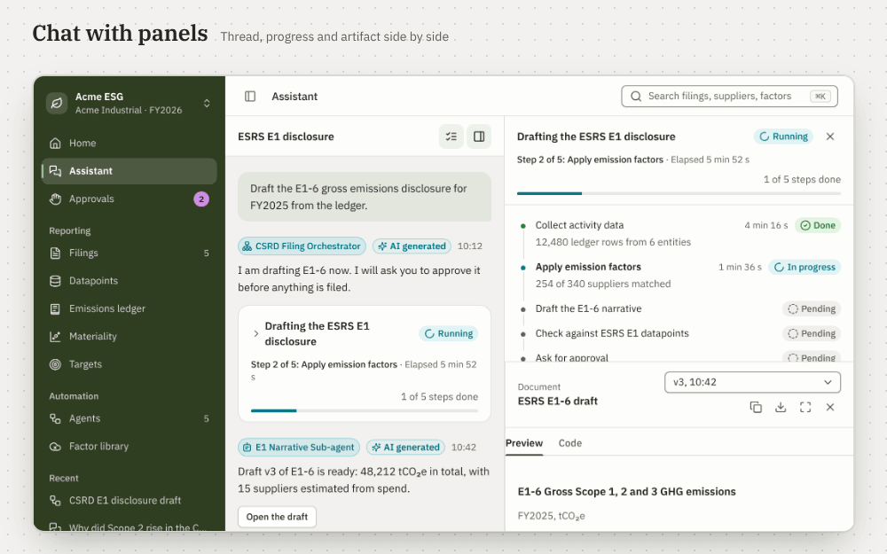</picture></a><br><sub><b>Chat with panels</b></sub> |
| <a href="https://saquibpm.github.io/faun-design-system"><picture><source media="(prefers-color-scheme: dark)" srcset="docs/assets/gallery-themes-dark.png">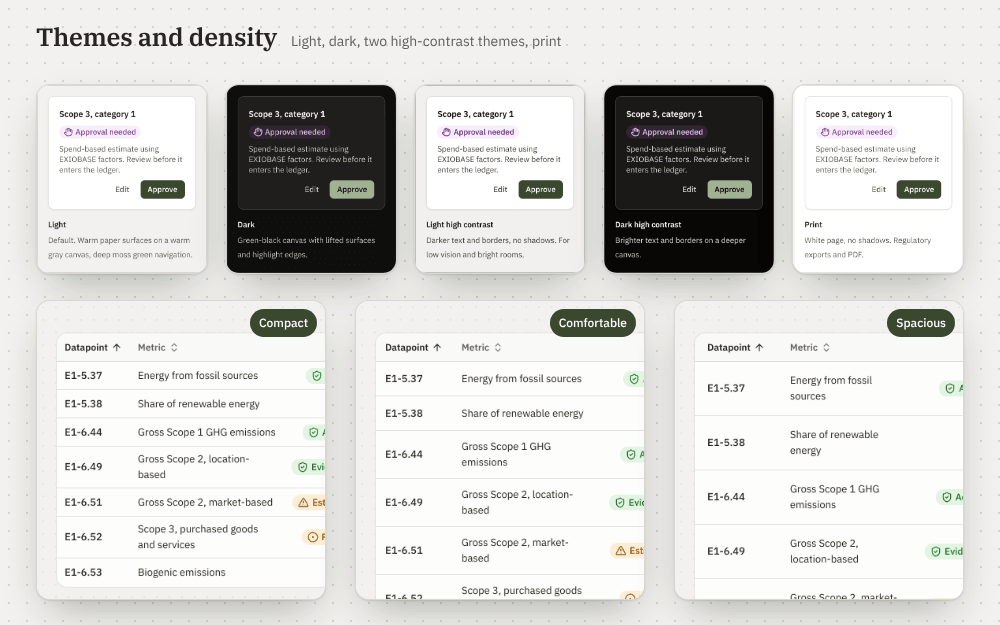</picture></a><br><sub><b>Themes and density</b></sub> | <a href="https://saquibpm.github.io/faun-design-system"><picture><source media="(prefers-color-scheme: dark)" srcset="docs/assets/gallery-mobile-dark.png">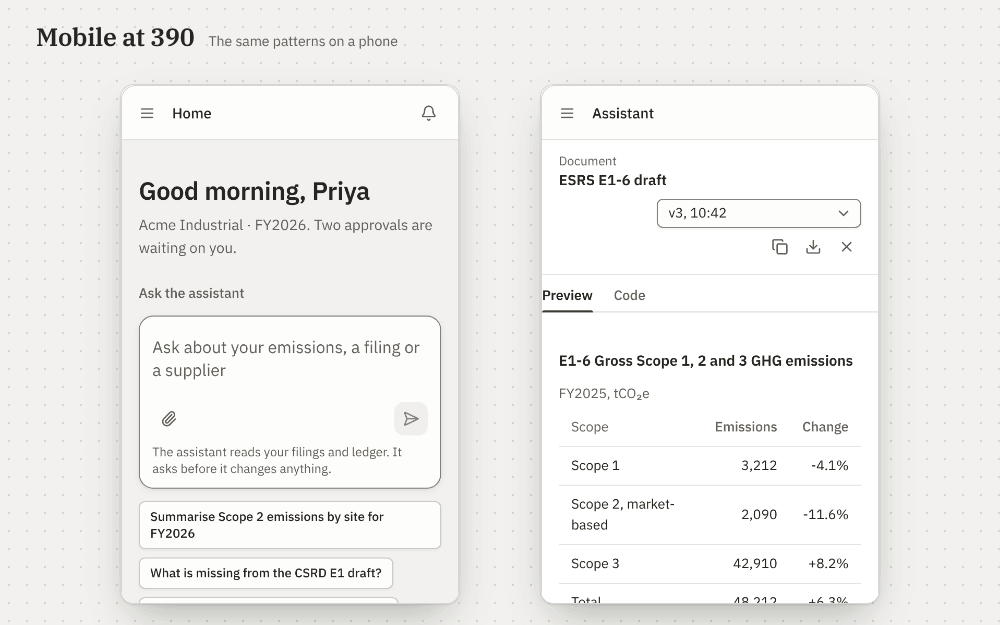</picture></a><br><sub><b>Mobile at 390 px</b></sub> |

## Why Faun

| Pillar | What you get |
| --- | --- |
| **Accessibility enforced at build** | Every foreground and background pair, in every theme, is measured on each build: 4.5:1 for text, 3:1 for control edges and chart marks, 7:1 in the high-contrast themes. One failure fails the build. The categorical chart palette is checked under protanopia and deuteranopia. |
| **Tokens first** | Colour, type, space, shape, motion and density as CSS variables, typed JS, DTCG JSON and a Tailwind v4 preset. Five themes, three densities, and a tenant accent generated from one colour. No provider, so it works with server rendering. |
| **Built for agents, and for agent-written code** | [`llms.txt`](apps/docs/public/llms.txt), an [MCP server](packages/mcp), [AGENTS.md](AGENTS.md) and an [ESLint plugin](packages/eslint-plugin) that rejects raw colours, arbitrary Tailwind values and unlabelled icon buttons. |
| **Data visualisation** | Bar, line, area, heatmap, Sankey and more, with textured marks, so meaning does not rest on hue alone, and three pastel palettes. |
| **Agentic components** | Run trails, approval cards that state the consequence of each choice, citations, provenance, confidence badges, streaming text, a prompt composer, progress and artifact panels. |
| **Independent and open** | Apache-2.0, its own visual identity, public decisions in [ADRs](docs/adr). |

## Install in three steps

Works with React 18.2+ and 19, in Vite, Next.js (App Router and Pages) and anything that bundles CSS. Node 20 or newer.

**1. Install**

```bash
npm install @faun-ds/tokens @faun-ds/icons @faun-ds/react
# optional: data table and charts, agentic components, layout grid
npm install @faun-ds/data @faun-ds/ai @faun-ds/grid
# optional: self-hosted IBM Plex fonts (recommended)
npm install @fontsource/ibm-plex-sans @fontsource/ibm-plex-serif @fontsource/ibm-plex-mono
```

**2. Load the styles and fonts, set the theme**

Import once at the root of the app, tokens first:

```tsx
import "@faun-ds/tokens/css";        // tokens: themes, density, motion modes
import "@faun-ds/tokens/fonts.css";  // IBM Plex via Fontsource (or "@faun-ds/tokens/css/fonts" for Google Fonts)
import "@faun-ds/tokens/css/base";   // element defaults and type classes
import "@faun-ds/react/styles.css";  // components
import "@faun-ds/data/styles.css";   // only if you use @faun-ds/data
import "@faun-ds/ai/styles.css";     // only if you use @faun-ds/ai
```

Themes and density are attributes. Themes: `light`, `dark`, `light-hc`, `dark-hc`, `print`, `system`. Density: `compact`, `comfortable`, `spacious`.

```html
<html lang="en" data-faun-theme="light" data-faun-density="comfortable">
```

**3. Build a screen (Vite and React)**

```bash
npm create vite@latest my-app -- --template react-ts
cd my-app && npm install @faun-ds/tokens @faun-ds/icons @faun-ds/react @faun-ds/data @faun-ds/ai \
  @fontsource/ibm-plex-sans @fontsource/ibm-plex-serif @fontsource/ibm-plex-mono
```

Delete `src/index.css` and `src/App.css` (the template styles fight the app shell), set the attributes on `<html>` in `index.html`, and use this `src/main.tsx`:

```tsx
import { StrictMode } from "react";
import { createRoot } from "react-dom/client";
import "@faun-ds/tokens/css";
import "@faun-ds/tokens/fonts.css";
import "@faun-ds/tokens/css/base";
import "@faun-ds/react/styles.css";
import "@faun-ds/data/styles.css";
import "@faun-ds/ai/styles.css";
import App from "./App";

createRoot(document.getElementById("root")!).render(<StrictMode><App /></StrictMode>);
```

and `src/App.tsx`, which renders the screen below:

```tsx
import { useState } from "react";
import {
  AppShell, Button, Card, CardBody, CardHeader, Field, Input, PageHeader, SideNav, SideNavItem,
  SideNavSection, SideNavWorkspace, StatusBadge, TooltipProvider,
} from "@faun-ds/react";
import { BarChart, DataTable, type DataTableColumn } from "@faun-ds/data";
import { PromptComposer } from "@faun-ds/ai";
import { IconHome, IconFileText, IconOrchestrator } from "@faun-ds/icons";

type Row = { id: string; site: string; scope1: number };
const rows: Row[] = [
  { id: "1", site: "Pune plant", scope1: 8200 },
  { id: "2", site: "Chennai plant", scope1: 5400 },
  { id: "3", site: "Rotterdam DC", scope1: 2100 },
];
const columns: DataTableColumn<Row>[] = [
  { id: "site", header: "Site", accessor: "site", sortable: true, rowHeader: true },
  { id: "scope1", header: "Scope 1 (tCO₂e)", accessor: "scope1", numeric: true, sortable: true },
];

export default function App() {
  const [sent, setSent] = useState("");
  return (
    <TooltipProvider>
      <AppShell
        nav={
          <SideNav workspace={<SideNavWorkspace mark={<IconOrchestrator />} name="Acme" context="FY2026" onSwitch={() => {}} />}>
            <SideNavSection>
              <SideNavItem href="#home" icon={<IconHome />} current>Home</SideNavItem>
              <SideNavItem href="#filings" icon={<IconFileText />}>Filings</SideNavItem>
            </SideNavSection>
          </SideNav>
        }
      >
        <PageHeader
          title="Emissions overview"
          status={<StatusBadge domain="run" state="awaiting_approval" />}
          actions={<Button intent="accent" variant="solid">Approve</Button>}
        />
        <Card>
          <CardHeader title="New facility" />
          <CardBody><Field label="Name"><Input placeholder="Facility name" /></Field></CardBody>
        </Card>
        <DataTable label="Sites" columns={columns} data={rows} getRowId={(r) => r.id} />
        <BarChart
          title="Scope 1 by site"
          unit="tCO₂e"
          categories={rows.map((r) => r.site)}
          series={[{ id: "s1", label: "Scope 1", values: rows.map((r) => r.scope1) }]}
        />
        <PromptComposer label="Ask the agent" placeholder="Ask about a disclosure" onSend={setSent} />
        {sent ? <p>Sent: {sent}</p> : null}
      </AppShell>
    </TooltipProvider>
  );
}
```

<picture>
  <source media="(prefers-color-scheme: dark)" srcset="docs/assets/quickstart-dark.png">
  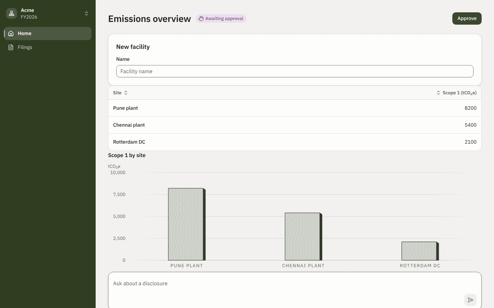
</picture>

<details>
<summary><b>Next.js (App Router), theming and troubleshooting</b></summary>

Components carry a `"use client"` directive, so Server Components can render them. Import the styles in `app/layout.tsx`:

```tsx
import type { ReactNode } from "react";
import "@faun-ds/tokens/css";
import "@faun-ds/tokens/fonts.css";
import "@faun-ds/tokens/css/base";
import "@faun-ds/react/styles.css";

export default function RootLayout({ children }: { children: ReactNode }) {
  return (
    <html lang="en" data-faun-theme="light" data-faun-density="comfortable">
      <body>{children}</body>
    </html>
  );
}
```

Props that are functions cannot cross from a Server Component to a client component, so put interactive trees in a file that starts with `"use client"`. To use `next/font`, skip the fonts import and set `--faun-font-family-sans: var(--font-plex-sans)` (and `serif`, `mono`).

Switch themes with `document.documentElement.dataset.faunTheme = "dark"`, scope a region with the attribute on any element, and brand a tenant from one colour:

```ts
import { createAccent } from "@faun-ds/tokens/theme";

const acme = createAccent("#0057B8");
if (acme.ok) document.head.insertAdjacentHTML("beforeend", `<style>${acme.css}</style>`);
```

Tailwind v4 users add one import: see the [Tailwind guide](https://saquibpm.github.io/faun-design-system/#/guides/tailwind).

- **Unstyled components:** a stylesheet import is missing, or `@faun-ds/tokens/css` came after the component styles.
- **`Can't resolve '@fontsource/ibm-plex-sans/400.css'`:** install the three `@fontsource/ibm-plex-*` packages, or import `@faun-ds/tokens/css/fonts`.
- **Two copies of React:** keep one `react` and one `react-dom` in the tree (`npm ls react`).

</details>

## Build an app in five minutes

Four pieces of the screen above, each as code and as rendered.

**1. A button and a form field**

```tsx
<Button variant="solid" intent="accent">Primary</Button>
<Button variant="outline">Secondary</Button>
<Button variant="soft" intent="accent">Soft</Button>
<Button variant="ghost">Tertiary</Button>
<Button variant="link" intent="accent">Link</Button>

<Field label="From"><Input defaultValue="1 Jan 2026" /></Field>
<Field label="To"><Input defaultValue="31 Dec 2026" /></Field>
```

<picture>
  <source media="(prefers-color-scheme: dark)" srcset="docs/assets/step-1-form-dark.png">
  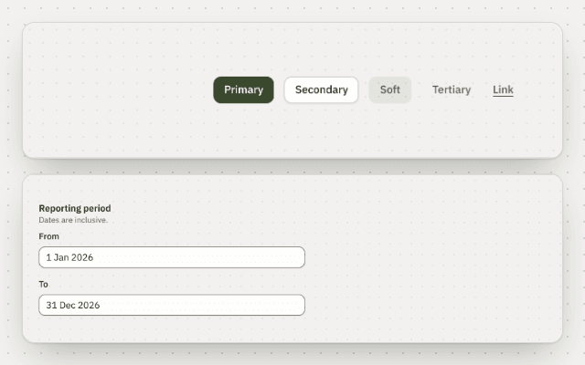
</picture>

**2. A sortable data table**

```tsx
const columns: DataTableColumn<Row>[] = [
  { id: "site", header: "Site", accessor: "site", sortable: true, rowHeader: true },
  { id: "scope1", header: "Scope 1 (tCO₂e)", accessor: "scope1", numeric: true, sortable: true },
];
<DataTable label="Sites" columns={columns} data={rows} getRowId={(r) => r.id} />
```

<picture>
  <source media="(prefers-color-scheme: dark)" srcset="docs/assets/step-2-table-dark.png">
  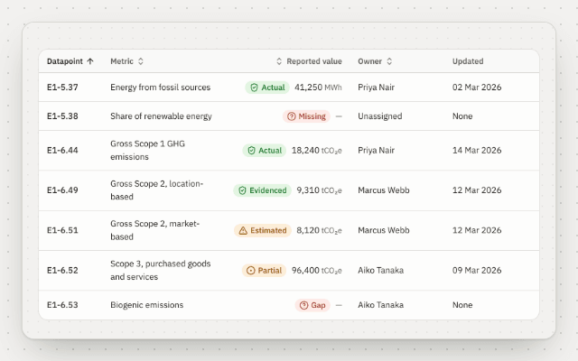
</picture>

**3. A chart**

```tsx
<BarChart
  title="Scope 1 by site" unit="tCO₂e"
  categories={rows.map((r) => r.site)}
  series={[{ id: "s1", label: "Scope 1", values: rows.map((r) => r.scope1) }]}
/>
```

<picture>
  <source media="(prefers-color-scheme: dark)" srcset="docs/assets/step-3-chart-dark.png">
  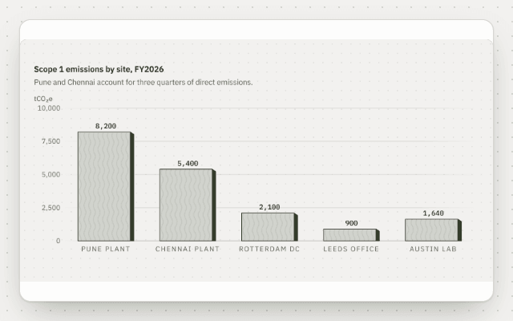
</picture>

**4. An assistant home**

```tsx
<AppShell nav={
  <SideNav workspace={<SideNavWorkspace mark={<IconOrchestrator />} name="Acme" context="FY2026" onSwitch={() => {}} />}>
    <SideNavSection><SideNavItem href="#home" icon={<IconHome />} current>Home</SideNavItem></SideNavSection>
  </SideNav>
}>
  <PageHeader title="Good morning, Priya" />
  <PromptComposer label="Ask the assistant" onSend={send} />
</AppShell>
```

<picture>
  <source media="(prefers-color-scheme: dark)" srcset="docs/assets/step-4-home-dark.png">
  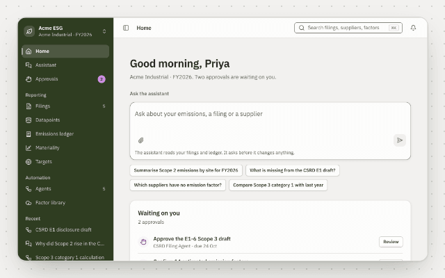
</picture>

The full assistant home is the [Assistant home pattern](https://saquibpm.github.io/faun-design-system/#/patterns/assistant-home). Every example is on the [documentation site](https://saquibpm.github.io/faun-design-system) with props, variants, usage rules and an accessibility section.

## Packages

| Package | What it is |
| --- | --- |
| [`@faun-ds/tokens`](packages/tokens) | Tokens as CSS variables, typed JS, JSON and a Tailwind v4 preset. Five themes, tenant accent generator, contrast contract. |
| [`@faun-ds/icons`](packages/icons) | 170+ accessible, tree-shakeable React icons, including glyphs for ESG and agent concepts. |
| [`@faun-ds/react`](packages/react) | Accessible components on Radix primitives, styled with plain CSS in cascade layers. |
| [`@faun-ds/data`](packages/data) | Data table, filters, charts and viewers for dense data. |
| [`@faun-ds/ai`](packages/ai) | Run trails, approval gates, citations, provenance, streaming and composer components. |
| [`@faun-ds/grid`](packages/grid) | 12-column responsive grid (4, 8 and 12 columns) as CSS and React. |
| [`@faun-ds/eslint-plugin`](packages/eslint-plugin) | Lint rules that enforce the system in generated and hand-written code. |
| [`@faun-ds/mcp`](packages/mcp) | MCP server that gives coding agents components, props, tokens, status map and icons. |
| [`apps/docs`](apps/docs) | The documentation site, generated from the code. |

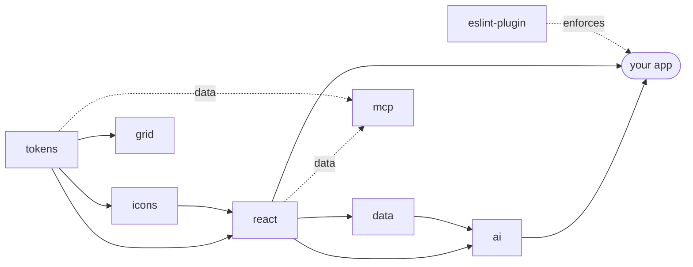

## Principles

- **The code is the source of truth.** Docs, props tables, the MCP data and `llms.txt` are generated from it ([ADR 0001](docs/adr/0001-code-is-the-source-of-truth.md)).
- **Status is never colour alone.** Seven tones, each with an icon and a label, from one map of domain states.
- **Tokens only.** Component CSS may not contain raw colours or sizes; a test enforces it.
- **People steer, agents act.** Machine and human actions are attributed, and consequential steps wait for a decision.
- **Dense, calm, printable.** Built for tables, long runs and regulatory output, with reduced motion, calm mode and forced colours.

## Status

Faun is pre-1.0 (`0.1.0`). Components and tokens are tested, but the API can still change. What has and has not been verified is listed in [docs/STATUS.md](docs/STATUS.md). Known gaps against Carbon are in [docs/audit](docs/audit).

## Roadmap

1. Close the P0 gaps from the parity audit (menu button, overflow menu, nested side navigation and more).
2. Per-component CSS, so consumers do not pay for one stylesheet per package.
3. Firefox and WebKit in CI, and a manual screen-reader pass.
4. 1.0 once the public API has held for several minor releases.

Details: [docs/ROADMAP.md](docs/ROADMAP.md).

## Contributing

```bash
pnpm install     # Node 22 (.nvmrc) and pnpm 9
pnpm build       # fails on any contrast failure
pnpm test && pnpm lint && pnpm typecheck
pnpm dev         # docs on http://localhost:5173
pnpm readme:shots  # regenerate the images in this README
```

Read [CONTRIBUTING.md](CONTRIBUTING.md) and [GOVERNANCE.md](GOVERNANCE.md). Participation is governed by the [Code of Conduct](CODE_OF_CONDUCT.md); security issues go through [SECURITY.md](SECURITY.md). Coding agents follow [AGENTS.md](AGENTS.md).

## License

[Apache-2.0](LICENSE). The documentation uses IBM Plex Sans, Serif and Mono under the SIL Open Font License. Faun is not affiliated with or endorsed by IBM.
